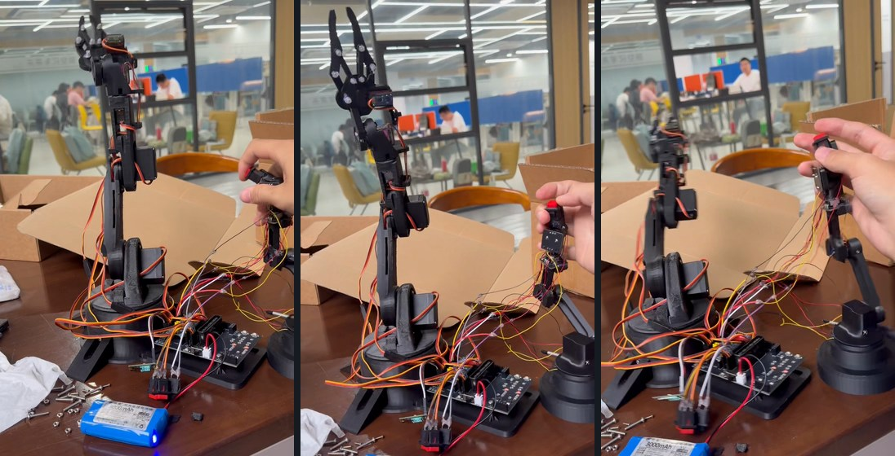

# STM32 双臂机械臂

手动操纵示教臂，执行臂随关节位置变化而动作。这是一套基于 STM32F103C8T6 的双臂实机项目。机械装配、接线、固件烧录和联动调试由 [@hongnuanhu](https://github.com/hongnuanhu) 完成。

## 实机演示

[观看 27 秒实机视频](media/robot-arm-demo.mp4) · [接线、烧录与调试](docs/wiring-and-flashing.md)

视频由搭建者在调试完成后拍摄。画面右侧的小臂用于手动示教，左侧的执行臂随之改变关节姿态。

| 时间 | 画面 |
| --- | --- |
| 00:00–00:06 | 台架、两只机械臂和主控接线的近景 |
| 00:10–00:16 | 手动拨动示教臂，执行臂抬起并改变姿态 |
| 00:18–00:24 | 继续调整示教臂，观察执行臂末端的朝向和高度变化 |

## 系统结构

示教臂的电位器把关节位置转换为模拟电压。主控采集这些电压，计算对应的舵机输出并直接产生 PWM。五路模拟输入对应五个关节，第六路 PWM 用于夹爪。

## 项目完成内容

| 环节 | 完成内容 |
| --- | --- |
| 机械装配 | 完成两只臂的底座、关节、舵机和执行端夹爪的安装 |
| 硬件接线 | 连接示教臂电位器、执行臂舵机和 STM32 主控 |
| 固件烧录 | 使用 Keil µVision 编译，通过 ST-LINK 的 SWD 接口下载 |
| 联动调试 | 操作示教臂并观察执行臂的跟随动作，记录整机运行画面 |

[查看引脚、烧录设置和联动检查步骤](docs/wiring-and-flashing.md)
